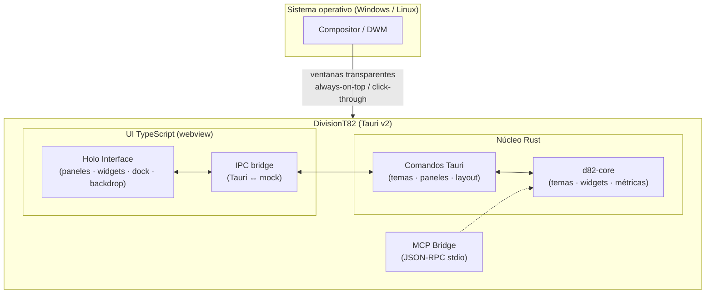

# Arquitectura de DivisionT82

> *Un shell, no un OS.* DivisionT82 nunca reemplaza el sistema operativo:
> flota sobre él usando las capacidades nativas de cada plataforma.

## Diagrama general

## Nivel 1 — Theme Engine

- **Fuente única de verdad:** `themes/*.d82theme.json`, validado por
  `themes/schema/theme.schema.json` (JSON Schema) y por `d82-core` (serde con
  `deny_unknown_fields` + validación manual espejo).
- Los 4 packs insignia van **embebidos en el binario** (`include_str!`), así el
  shell siempre arranca aunque el usuario borre su carpeta de temas.
- Packs personalizados: se sueltan en `<appdata>/themes/` y se descubren en
  caliente — sin recompilar.
- La UI consume los packs y los aplana a variables CSS `--d82-*`; todo el
  look (glass, blur, glow, grid) es CSS puro derivado del pack.
- Matemática de color (WCAG): `contrast_ratio`, `relative_luminance` — con
  test que garantiza legibilidad AA de los packs insignia.

## Nivel 2 — Widget Engine

- `d82-core::sys` colecta CPU/RAM con `sysinfo` (snapshot por invocación).
- El host Tauri expone `metrics_snapshot`; la UI hace polling 1 s y mantiene
  historial para sparklines.
- Los widgets son componentes React registrados en `WIDGET_REGISTRY`, mapeados
  1:1 con `d82_core::widgets::WidgetKind`.
- El layout (paneles + widgets + geometría) es un documento JSON versionable
  (`Layout`), persistido en `<appdata>/layout.json`.

## Nivel 3 — Holo Interface

- Cada panel visible del shell real es una **ventana Tauri independiente**:
  `decorations=false`, `transparent=true`, `always_on_top`, `skip_taskbar`,
  etiqueta `panel-*` (capability por patrón glob).
- **Click-through** real vía `set_ignore_cursor_events` — mismo truco de
  Rainmeter, pero multiplataforma a través de Tauri.
- Snap magnético a bordes, colapso, pin, persistencia de posición.
- Backdrop holográfico: gradiente del tema, grid, partículas
  (`dust | matrix | orbit`), scanlines, noise, vignette — todo configurable
  por pack y respetuoso con `prefers-reduced-motion`.

## Estrategia por plataforma

| Objetivo | Estrategia |
|---|---|
| Windows 10/11 | Ventanas flotantes nativas (sin API de compositor); Acrylic/Mica vía `window-vibrancy` (planeado v0.2) |
| Linux X11 | Funciona directo |
| Linux Wayland | Fase 1: ventanas genéricas. Fase 2: adaptador `layer-shell` opcional para Hyprland/Sway/KDE |
| GNOME | No objetivo soportado (hostil a ventanas ancladas transparentes) |

## Decisiones deliberadas (lecciones de Serpantinum)

1. **No gestionar keybinds, monitores ni taskbar** → superficie de
   mantenimiento mínima.
2. **No tematizar apps de terceros** → el 60% de los fixes de un shell que
   recolorea Spotify/Discord/Steam son peleas con configs ajenas; aquí el
   theming es 100% interno.
3. **Daemons pequeños y separables** → el core no depende de Tauri;
   `cargo test -p d82-core` corre en cualquier CI sin dependencias de sistema.
